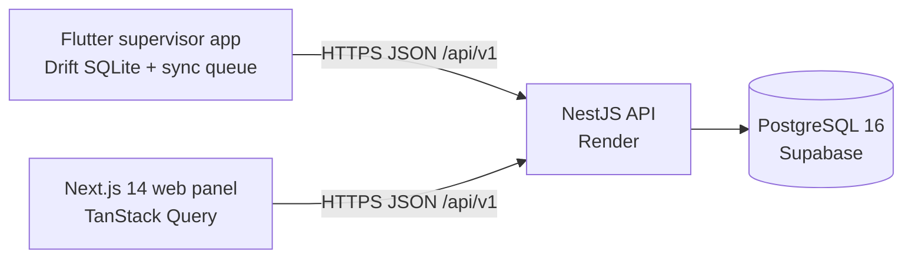
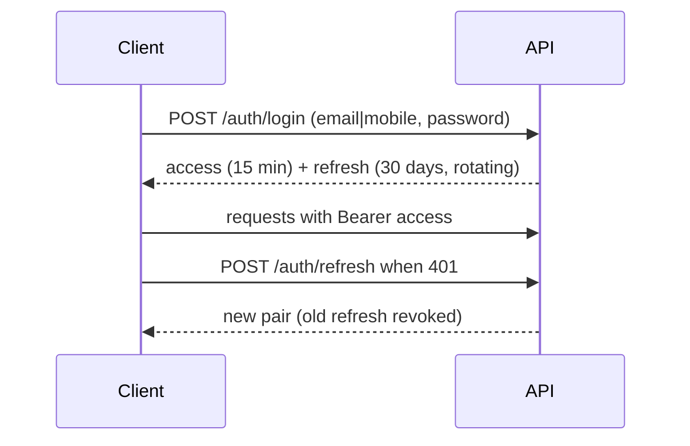
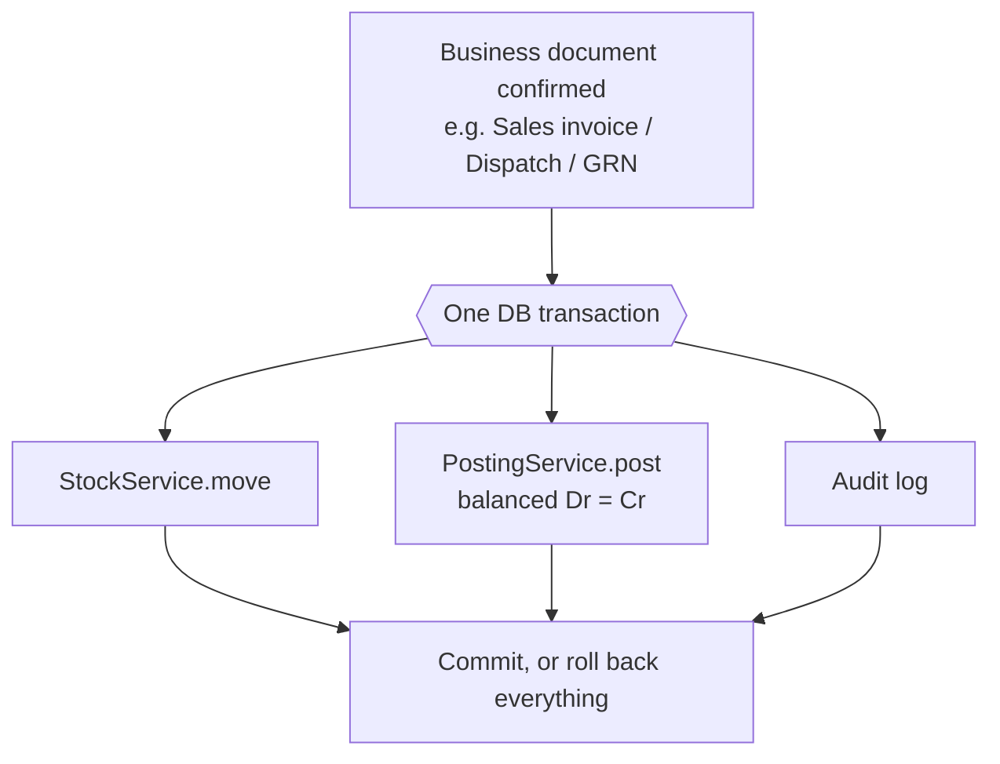

# 02 — Architecture

## Backend layers
Controller (validate DTO) → Service (business rules) → Repository (TypeORM, tenant-filtered). Cross-cutting: auth guard, tenant guard, permission guard, response envelope interceptor, error filter, audit subscriber.
Two core engines that every module uses: **StockService** (the only way stock changes) and **PostingService** (the only way journals are written).

## Multi-tenancy
Every business table has `company_id`. The active company comes from the JWT (user picks a company after login). Repositories always add `company_id = :tenant`. Clients never send `company_id`. Kiln access is a second filter (`user_sites`).

## Auth flow

## Event → stock → accounting

## Offline sync (summary)
Mobile writes to Drift and enqueues; SyncService pushes with `Idempotency-Key` = record UUID; the server is the authority for stock and accounting. Details: [09-offline-sync.md](09-offline-sync.md).
