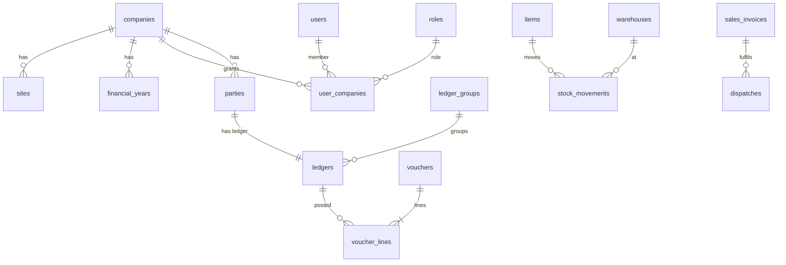

# 06 — Database

PostgreSQL 16 (Supabase in prod, docker-compose locally). TypeORM entities + **migrations only** (never `synchronize`). The compact table list is in [`.brain/DB_SCHEMA.md`](../.brain/DB_SCHEMA.md).

## Naming
snake_case plural tables (`sales_invoices`), snake_case columns, FK `<entity>_id`, money `NUMERIC(18,2)`, quantities `INTEGER`, uuid PKs, `created_at/updated_at/created_by/updated_by`, `deleted_at` for soft delete, `company_id` on every business table (indexed, usually the first column of composite indexes).

## Core ERD (planned)


## Migrations how-to
```bash
# after changing entities
pnpm --filter @brics/backend migration:generate src/database/migrations/AddParties
# review the generated SQL, then
pnpm --filter @brics/backend migration:run
pnpm --filter @brics/backend migration:revert   # local only
```
Rules: one migration per logical change; never edit a migration that has run anywhere shared; seed reference data (roles, CoA, voucher types) through idempotent seeds in `src/database/seeds/`.
