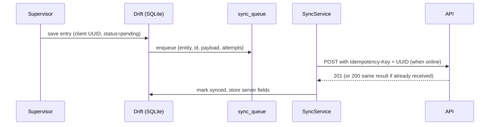

# 09 — Offline sync (supervisor app)

Kilns often have weak or no network. The app must work **a full day offline** and sync later **without duplicates**.

## Design

## Rules

- **Client-generated UUIDs** for every record created on the phone.
- **Write local first**, then enqueue. The UI shows the per-record and global status (pending / synced / failed) with `SyncStatusBadge`.
- **Idempotent server**: the same `Idempotency-Key` returns the original response; no second stock movement or voucher.
- **Retry with exponential backoff** (5 s → 30 s → 2 min → 10 min, capped). Retry on connectivity regained and app resume. Manual "Sync now".
- **Server is the authority** for stock and accounting. If the server rejects an entry (e.g. kiln closed, FY locked, validation failed), the record becomes `failed` with the reason and the supervisor can fix and resend.
- **Conflicts:** field records (production, attendance, GRN, challan) are append-mostly. Edits after sync are allowed only until the server confirms the document; later changes go through the web panel. Masters on the phone (parties, items, brick types, vehicles) are **read-only caches** pulled by `updated_since`.
- **Ordering:** the queue is FIFO per entity type; dependent records (challan after dispatch) carry the parent UUID.

## Tables (mobile, Drift) — as built (M1, ADR-053)

- `sync_queue (id, entity, method, path, payload, depends_on, status, attempts, next_attempt_at, last_error_code, last_error, server_id, server_ref, response, title, site_id, user_id, company_id, created_at, updated_at, synced_at)`.
  **The queue row is the field record** — no separate per-feature table, because a record the server has accepted is never edited on the phone.
  `id` is the client UUID and the `Idempotency-Key`. `path` may hold `{parent}`, replaced at send time by the server id of the `depends_on` entry.
- `cached_records (kind, id, site_id, json)` — master caches and the open batches / challans the supervisor acts on.
- `app_state (key, value)` — delta watermarks, selected kiln, last sync time.

## As built — details the design above did not spell out

- **Retry on reconnect is immediate:** regaining signal pulls every backing-off entry forward instead of waiting out its timer.
- **Blocked children are not "due":** an entry waiting on a refused parent does not wake the sync; it is shown as _Waiting on another entry_.
- **Non-idempotent steps:** dispatch confirm / acknowledge are `PATCH`es that change state. A resend after a lost answer is refused with
  `DISPATCH_NOT_DRAFT` / `DISPATCH_ALREADY_DELIVERED`; the app reads the challan back and counts the entry as sent if the challan is in
  the state it asked for.
- **Sessions:** a 401 leaves the entry waiting; only a _refused_ refresh signs the person out, and the queue survives it. Entries are only
  ever sent with their author's token.
- **Housekeeping:** sent entries are pruned after 30 days; an app killed mid-send puts `syncing` rows back to `pending` on start.
- **Test:** `mobile/test/sync/full_day_offline_test.dart` enters 21 entries across the four features offline, then syncs through lost
  responses and a 503, and asserts every server-side create happened exactly once and every batch's stages arrived in order.
