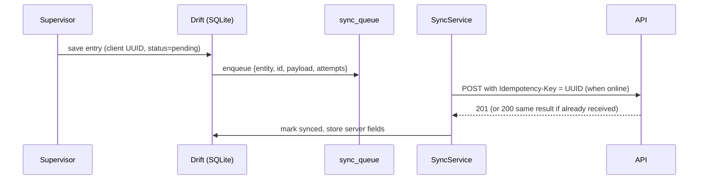

# 09 — Offline sync (supervisor app)

Kilns often have weak or no network. The app must work **a full day offline** and sync later **without duplicates**.

## Design

## Rules
- **Client-generated UUIDs** for every record created on the phone.
- **Write local first**, then enqueue. The UI shows the per-record and global status (pending / synced / failed) with `SyncStatusBadge`.
- **Idempotent server**: the same `Idempotency-Key` returns the original response; no second stock movement or voucher.
- **Retry with exponential backoff** (5 s → 30 s → 2 min → 10 min, capped). Retry on connectivity regained and app resume. Manual "Sync now".
- **Server is the authority** for stock and accounting. If the server rejects an entry (e.g. kiln closed, FY locked, validation failed), the record becomes `failed` with the reason and the supervisor can fix and resend.
- **Conflicts:** field records (production, attendance, GRN, challan) are append-mostly. Edits after sync are allowed only until the server confirms the document; later changes go through the web panel. Masters on the phone (parties, items, brick types, vehicles) are **read-only caches** pulled by `updated_since`.
- **Ordering:** the queue is FIFO per entity type; dependent records (challan after dispatch) carry the parent UUID.

## Tables (mobile, Drift)
`sync_queue (id, entity, record_id, op, payload_json, attempts, last_error, next_attempt_at)` + one table per feature + master caches.
